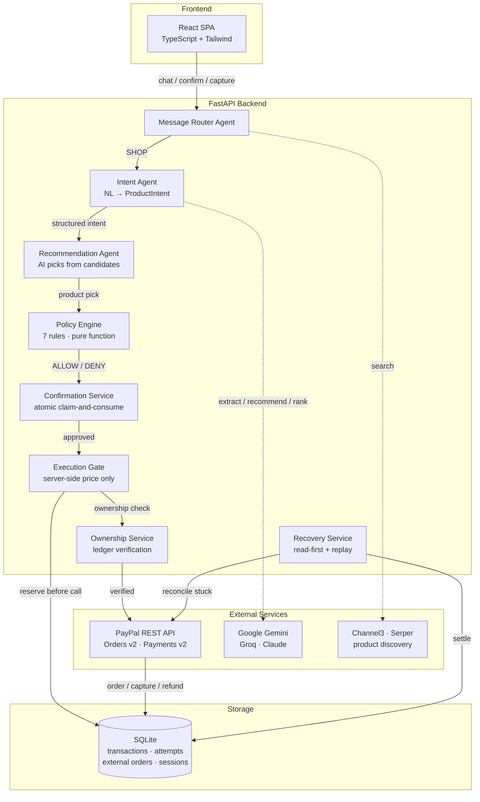

# PayPilot

**AI-Assisted Payment Orchestration Platform**

PayPilot is a conversational payment system that translates natural-language purchasing requests into real PayPal transactions. Users describe what they want to buy in plain English; the system interprets their intent with AI, recommends products, enforces deterministic spending rules, and — only after explicit human confirmation — creates, captures, and manages real PayPal orders.

The core design principle: **AI recommends, policy authorizes, PayPal executes.** No AI output can directly cause money to move.

---

## Problem Statement

Connecting conversational AI to real payment systems creates a fundamental trust boundary problem. An LLM can interpret user intent and recommend products, but it must never autonomously decide to move money. If a model hallucinates a price, misinterprets intent, or is manipulated through prompt injection, real financial transactions could be triggered without authorization.

Payment operations are also inherently unreliable: network timeouts, process crashes, and concurrent requests can leave transactions in ambiguous states — orders created but not recorded, captures initiated but not confirmed, refunds started but not completed. A payment system must recover from every failure mode without duplicating transactions or losing money.

PayPilot solves both problems through **architectural separation** (AI is advisory only; a deterministic policy engine is the sole authorization authority) and a **layered reliability architecture** (durable reservations, idempotency, atomic concurrency claims, and operator-gated recovery).

---

## Solution

PayPilot enforces strict trust boundaries between each layer of the system:

1. **Conversational Interface** — Routes user messages and persists chat sessions.
2. **AI Decision Pipeline** — Interprets intent and recommends products (advisory only; never sees payment amounts or authorization decisions).
3. **Deterministic Policy Engine** — A pure function with seven rules and zero AI dependency that is the sole authority on whether a purchase is permitted.
4. **Execution Gate** — Bridges policy to PayPal; derives all amounts from server-side catalog data, never from AI output or client input.
5. **PayPal Integration** — Thin, well-typed client over PayPal's REST APIs with explicit timeouts.
6. **Persistence & Recovery** — SQLite ledgers with durable pre-flight reservations, committed before every PayPal call so a crash never leaves an orphaned order.

---

## Key Features

### Conversational AI
- Natural-language intent extraction via Google Gemini, Groq, or Anthropic Claude
- AI-powered product recommendation from filtered catalog candidates
- Message routing (SHOP, REFUND, HISTORY, SMALLTALK)
- Session-persistent conversational context

### Product Discovery
- Internal product catalog with category and constraint-based search
- External product discovery via Channel3 and Serper (Google Shopping) providers
- AI-ranked product comparison with server-validated candidate IDs
- Product adoption, revalidation, and evidence-based intake pipeline

### Deterministic Policy Engine
- Seven rules in first-match order: invalid price, unsupported currency, no purchase requested, shopping constraints, autonomy not granted, no limit set, within/exceeds limit
- Three outcomes: `ALLOW_AUTONOMOUS_PURCHASE`, `REQUIRE_USER_APPROVAL`, `DENY`
- Pure function — no AI, no network calls, no side effects

### Payment Operations (PayPal)
- PayPal Orders v2: create and capture
- PayPal Payments v2: full refund
- PayPal Notifications v1: webhook signature verification
- Server-side checkout URL validation (HTTPS-only)
- OAuth 2.0 token acquisition with credential isolation

### Human Approval
- Explicit confirmation required before every payment operation
- External products always require human approval, even when policy allows autonomous purchase
- Atomic claim-and-consume confirmation prevents concurrent double-execution

### Reliability & Recovery
- Durable pre-flight reservations committed before PayPal API calls
- PayPal-Request-Id idempotency tagging on order creation
- Read-first recovery for stuck transactions with PayPal verification
- Operator-gated replay recovery within conservative idempotency windows
- UUID-based recovery ownership tokens preventing stale-worker interference
- Desync-aware error reporting when PayPal succeeds but ledger writes fail

### Concurrency & Ownership
- Atomic conditional UPDATE claims for refunds and recovery (SQLite serialization)
- Server-side order ownership resolution before every money-moving call
- Three-owner model: CATALOG, EXTERNAL, UNKNOWN — each with explicit handling
- UNIQUE constraints on order IDs and approval IDs preventing duplicates

### Transaction Management
- Full lifecycle tracking: ORDER_CREATED → CAPTURED → REFUNDING → REFUNDED
- Transaction history with status filtering
- Multi-path webhook reconciliation across catalog, external, and attempt ledgers

---

## Technology Stack

| Layer | Technology |
|-------|-----------|
| Backend | Python 3.12, FastAPI 0.115.5, Starlette 0.41.3 |
| Frontend | React 19, TypeScript 5.8, Vite 7, Tailwind CSS 4 |
| Database | SQLite (stdlib `sqlite3`) |
| AI Providers | Google Gemini (`google-genai`), Groq, Anthropic Claude |
| Payment | PayPal REST API — Orders v2, Payments v2, Notifications v1 |
| HTTP Client | httpx 0.28 |
| Backend Testing | pytest 8.3 (2,339 tests) |
| Frontend Testing | Vitest 4.1 (182 tests) |

---

## Architecture



**Trust boundary:** The AI agents (Intent, Recommend, Router) are advisory only. They produce structured interpretations validated against Pydantic schemas with `extra="forbid"`. The Policy Engine is the sole authorization authority. The Execution Gate derives all payment amounts from the server-side product catalog — never from AI output, client input, or discovery data.

---

## Quick Start for Hackathon Judges

Get PayPilot running in under 5 minutes. You need **Python 3.12+**, **Node.js 18+**, and API keys for **PayPal Sandbox** and at least **one AI provider** (Gemini, Groq, or Anthropic).

### 1. Clone and configure

```powershell
git clone https://github.com/deepak-158/PayPilot.git
cd PayPilot

# Backend credentials
cd backend
copy .env.example .env
# Open backend\.env and fill in:
#   PAYPAL_CLIENT_ID, PAYPAL_CLIENT_SECRET (from developer.paypal.com → Sandbox)
#   AI_PROVIDER (gemini, groq, or claude) and the matching API key
#   PAYPILOT_API_KEY (any long random string — this is your login password)
#   PAYPILOT_AUTH_SECRET (any long random string — used for token signing)
```

### 2. Install dependencies

```powershell
# Backend (from PayPilot/backend)
python -m venv .venv
.venv\Scripts\activate
pip install -r requirements.txt

# Frontend (from PayPilot/frontend)
cd ..\frontend
npm install
```

### 3. Start both servers

Open **two terminals**:

```powershell
# Terminal 1 — Backend
cd PayPilot\backend
.venv\Scripts\activate
uvicorn app.main:app --host 127.0.0.1 --port 8000
```

```powershell
# Terminal 2 — Frontend
cd PayPilot\frontend
npm run dev
```

### 4. Open the app

Navigate to **http://localhost:5173**. The header shows **Backend connected** when ready. Log in with the `PAYPILOT_API_KEY` value you set in `.env`.

### 5. Try a conversation

Type a natural-language shopping request in the chat. The system will extract your intent, recommend a product, evaluate spending policy, and — with your explicit approval — create a real PayPal Sandbox order.

**Sample prompts to try:**

| Prompt | What happens |
|--------|-------------|
| `I want to buy a laptop under 70000 rupees, auto-approve if under 60000` | AI extracts intent → filters catalog → recommends HP Pavilion 14 (₹68,990) → policy returns REQUIRE_USER_APPROVAL (price exceeds auto-approve limit) → waits for your confirmation |
| `Buy me the cheapest headphones you have` | AI finds boAt Rockerz 450 (₹1,499) → depending on your constraints, may auto-approve or ask |
| `Show me my recent transactions` | Routes to HISTORY → displays transaction log |
| `Refund my last order` | Routes to REFUND → looks up last captured order → initiates PayPal refund |

### Verification without API keys

If you only want to verify the codebase (no live demo):

```powershell
# Run the full test suite (no API keys required)
cd backend
python -m pytest tests/ -q        # → 2,339 passed

cd ..\frontend
npm run test                      # → 182 passed
```

The backend also starts without AI keys — it returns clear 503 errors for AI endpoints while all other endpoints (products, policy, auth, transactions) work normally.

### Key URLs

| URL | What it shows |
|-----|---------------|
| http://localhost:5173 | Full application UI |
| http://localhost:8000/docs | Interactive Swagger API documentation |
| http://localhost:8000/ | Health check (`{"service": "PayPilot", "status": "running"}`) |

---

## Prerequisites

| Requirement | Version | Notes |
|------------|---------|-------|
| Python | 3.12+ | Tested with 3.12.10 |
| Node.js | 18+ | Tested with 24.19.0 |
| npm | 8+ | Tested with 11.17.0 |
| Git | Any recent | For version control |
| PayPal Developer Account | — | [developer.paypal.com](https://developer.paypal.com) — free Sandbox account |
| AI Provider API Key | — | At least one of: [Google AI Studio](https://aistudio.google.com/apikey) (Gemini), [Groq Console](https://console.groq.com/keys), or Anthropic |

---

## Environment Configuration

Both the backend and frontend use `.env` files. Templates are provided as `.env.example`.

### Backend (`backend/.env`)

Copy the template and fill in your credentials:

```powershell
# Windows
cd backend
copy .env.example .env
```

```bash
# Linux / macOS
cd backend
cp .env.example .env
```

#### Required Variables

| Variable | Description |
|----------|-------------|
| `PAYPAL_CLIENT_ID` | PayPal Sandbox app client ID |
| `PAYPAL_CLIENT_SECRET` | PayPal Sandbox app secret |
| `PAYPAL_ENVIRONMENT` | Always `sandbox` |
| `PAYPAL_WEBHOOK_ID` | Webhook ID from PayPal Developer Dashboard |
| `AI_PROVIDER` | `gemini` (default), `groq`, or `claude` |
| `PAYPILOT_API_KEY` | Operator login credential (use a long random string) |
| `PAYPILOT_AUTH_SECRET` | HMAC-SHA256 signing secret for bearer tokens |

Generate secure operator credentials:

```bash
python -c "import secrets; print(secrets.token_urlsafe(48))"
```

#### AI Provider Keys (set the one matching `AI_PROVIDER`)

| Variable | Provider |
|----------|----------|
| `GEMINI_API_KEY` | Google Gemini (default model: `gemini-3.5-flash`) |
| `GROQ_API_KEY` | Groq (default model: `openai/gpt-oss-20b`) |
| `CLAUDE_API_KEY` | Anthropic Claude (default model: `claude-opus-5-5`) |

#### Optional Variables

| Variable | Default | Description |
|----------|---------|-------------|
| `GEMINI_MODEL` | `gemini-3.5-flash` | Override Gemini model |
| `GROQ_MODEL` | `openai/gpt-oss-20b` | Override Groq model |
| `CLAUDE_MODEL` | `claude-opus-5-5` | Override Claude model |
| `DISCOVERY_PROVIDER` | `channel3` | `channel3` or `serper` for product discovery |
| `CHANNEL3_API_KEY` | — | Required if `DISCOVERY_PROVIDER=channel3` |
| `SERPER_API_KEY` | — | Required if `DISCOVERY_PROVIDER=serper` |
| `PAYPAL_RETURN_URL` | `https://example.com/paypilot/return` | Where PayPal sends buyer after approval (must be HTTPS) |
| `PAYPAL_CANCEL_URL` | `https://example.com/paypilot/cancel` | Where PayPal sends buyer on cancellation (must be HTTPS) |
| `EXTERNAL_REVALIDATION_TTL_SECONDS` | `300` | Freshness window for external product evidence |
| `EXTERNAL_CAPTURE_WINDOW_SECONDS` | `900` | How long a capture authorization stays valid |
| `DISCOVERY_USD_INR_RATE` | `91.25` | Demo conversion rate for discovery display only |
| `PAYPILOT_CORS_ORIGINS` | `http://localhost:5173` | Comma-separated allowed CORS origins |

See `backend/.env.example` for detailed documentation of every variable.

### Frontend (`frontend/.env`)

```powershell
# Windows
cd frontend
copy .env.example .env
```

| Variable | Default | Description |
|----------|---------|-------------|
| `VITE_API_BASE_URL` | `http://localhost:8000` | Backend API base URL. When using the Vite proxy (default dev setup), leave this unset or empty — the frontend sends relative requests that Vite proxies to the backend. |

> **Security:** Never put backend secrets (`PAYPAL_CLIENT_SECRET`, API keys, `PAYPILOT_AUTH_SECRET`) in any `VITE_`-prefixed variable. `VITE_` variables are bundled into the browser-visible JavaScript.

---

## Installation

### Backend

```powershell
# Windows PowerShell
cd backend
python -m venv .venv
.venv\Scripts\activate
pip install -r requirements.txt
```

```bash
# Linux / macOS
cd backend
python -m venv .venv
source .venv/bin/activate
pip install -r requirements.txt
```

### Frontend

```bash
cd frontend
npm install
```

### Database

No manual migration is needed. The SQLite database (`backend/data/paypilot.db`) is created automatically on first startup with all required tables.

---

## Running the Application

### 1. Start the Backend

```powershell
cd backend
uvicorn app.main:app --reload --host 127.0.0.1 --port 8000
```

The API server starts at **http://127.0.0.1:8000**. Interactive API documentation is available at **http://127.0.0.1:8000/docs**.

### 2. Start the Frontend

```bash
cd frontend
npm run dev
```

The frontend starts at **http://localhost:5173** with Vite's dev server. It proxies API requests (`/auth`, `/chat`, `/products`, `/purchase`, `/transactions`, `/sessions`, `/discovery`, `/webhooks/paypal`) to the backend automatically — no CORS issues in development.

### 3. Access the Application

Open **http://localhost:5173** in your browser. The header shows a **Backend connected** / **Backend unavailable** indicator. Log in with the operator API key configured in `PAYPILOT_API_KEY`.

#### Ports

| Service | Port |
|---------|------|
| Backend (FastAPI) | 8000 |
| Frontend (Vite) | 5173 |

---

## PayPal Sandbox Setup

1. Create a PayPal Developer account at [developer.paypal.com](https://developer.paypal.com).
2. Navigate to **Dashboard → Apps & Credentials → Sandbox**.
3. Create a new app (or use the default Sandbox app).
4. Copy the **Client ID** and **Secret** into `backend/.env`.
5. Under **Webhooks**, add a webhook URL pointing to your server's `/webhooks/paypal` endpoint. Copy the **Webhook ID** into `PAYPAL_WEBHOOK_ID`.

### Buyer Approval and Capture Workflow

1. The system creates a PayPal order via `POST /v2/checkout/orders`.
2. PayPal returns an approval URL — the buyer must approve the order on PayPal's hosted checkout page.
3. After the buyer approves, capture the order via the frontend or `POST /purchase/capture/{order_id}`.
4. The system verifies ownership, calls PayPal's capture endpoint, and updates the local ledger.

For local development with PayPal's return redirects, you can use a tunnel service (e.g., ngrok) to expose your Vite dev server over HTTPS, then set `PAYPAL_RETURN_URL` and `PAYPAL_CANCEL_URL` to that HTTPS domain. Pass the tunnel hostname to Vite:

```bash
# Before starting the frontend
set VITE_ALLOWED_HOST=your-tunnel-hostname.ngrok-free.dev
npm run dev
```

---

## AI Provider Configuration

PayPilot supports three AI providers for intent extraction, product recommendation, message routing, and product ranking:

| Provider | `AI_PROVIDER` | Key Variable | Default Model |
|----------|---------------|-------------|---------------|
| Google Gemini | `gemini` | `GEMINI_API_KEY` | `gemini-3.5-flash` |
| Groq | `groq` | `GROQ_API_KEY` | `openai/gpt-oss-20b` |
| Anthropic Claude | `claude` | `CLAUDE_API_KEY` | `claude-opus-5-5` |

Set `AI_PROVIDER` in `backend/.env` and provide the corresponding API key. Only one provider is active at a time. The AI provider is used for four tasks:

- **Intent extraction:** Natural language → structured `ProductIntent`
- **Product recommendation:** Filtered candidates → best pick with reasoning
- **Message classification:** Route messages to SHOP / REFUND / HISTORY / SMALLTALK
- **Product ranking:** Rank discovery results for comparison

All AI outputs are validated against Pydantic schemas with `extra="forbid"` — the AI cannot inject unexpected fields.

---

## Testing

### Backend Tests

```powershell
cd backend
python -m pytest tests/ -q
```

Expected output: **2,339 passed**. All tests use mocked PayPal and AI calls with isolated per-test SQLite databases. No real API calls are made during testing.

### Frontend Tests

```bash
cd frontend
npm run test
```

Expected output: **182 passed** across 18 test files.

### Full Regression Suite

Run both in sequence:

```powershell
cd backend
python -m pytest tests/ -q
cd ..\frontend
npm run test
```

### What the Tests Cover

| Category | Tests | Key Scenarios |
|----------|-------|---------------|
| Payment lifecycle | ~75 | Create, capture, refund; ownership gates; double-capture/refund prevention |
| Policy engine | 26 | All 7 rules; boundary values; invalid prices; currency rejection |
| Recovery & idempotency | ~115 | Read-first recovery, replay recovery, window classification, claim ownership |
| External product pipeline | ~530 | Adoption, revalidation, policy, approval, order creation, buyer verification, capture |
| Webhook verification | 28 | Header extraction, signature verification, per-event-type reconciliation |
| AI agents | ~65 | Intent parsing, recommendation validation, routing, ranking |
| Discovery | ~280 | Provider integration, filtering, currency normalization, evidence store |
| Auth & sessions | ~70 | Token issuance/verification, login, session management, confirmation |
| Infrastructure | ~50 | CORS, checkout URLs, currency conversion, product search, transaction history |
| Frontend | 182 | API client contracts, component rendering, error handling, security guarantees |

---

## API Documentation

Start the backend and visit **http://127.0.0.1:8000/docs** for interactive Swagger/OpenAPI documentation with all endpoints, request/response schemas, and the ability to test calls directly.

### Endpoint Groups

| Group | Prefix | Description |
|-------|--------|-------------|
| Auth | `/auth` | Operator login and health check |
| Products | `/products` | Catalog listing, search, and lookup |
| AI | `/ai` | Intent extraction, recommendation, purchase planning |
| Policy | `/policy` | Deterministic policy evaluation |
| Purchase | `/purchase` | Execute, approve, and capture catalog purchases |
| Chat | `/chat` | Conversational shopping interface |
| Sessions | `/sessions` | Session retrieval and confirmation |
| Transactions | `/transactions` | History, refund, and order lookup |
| Discovery | `/discovery` | External product search and comparison |
| Adoption | (in main) | External product adoption and revalidation |
| External | (in main) | External policy, approval, order creation, verification, capture |
| Webhooks | `/webhooks` | PayPal webhook receiver with signature verification |
| Recovery | (in main) | Operator-gated stuck transaction recovery |

---

## Security Architecture

| Principle | Implementation |
|-----------|---------------|
| **AI-policy separation** | AI agents produce structured interpretations only. The policy engine is a pure function with zero AI dependency. |
| **Server-side price resolution** | Payment amounts come from the server-side catalog or server-held revalidation evidence — never from AI output, client input, or discovery data. |
| **Human approval gates** | Explicit confirmation before every payment. External products always require approval, even when policy allows autonomous purchase. |
| **Idempotency** | PayPal-Request-Id on order creation. Adoption, approval, capture, and order creation are all idempotent. |
| **Recovery ownership** | UUID-based claim tokens prevent concurrent recovery races. Ownership-guarded release ensures only the original claimant can release a lock. |
| **Webhook verification** | PayPal's official `verify-webhook-signature` API with all five required transmission headers. |
| **Credential isolation** | All secrets loaded from environment variables. Never logged, returned in API responses, or exposed to frontend code. Constant-time comparison for operator authentication. |
| **Fail-closed auth** | If `PAYPILOT_API_KEY` or `PAYPILOT_AUTH_SECRET` is unset, all protected routes return 401. |
| **Input validation** | Pydantic schemas with `extra="forbid"`. Checkout URLs validated (HTTPS-only, no whitespace, no control characters). |

---

## Known Limitations

| Limitation | Detail |
|------------|--------|
| **SQLite** | Single-writer serialization is correct but limits concurrent throughput. Suitable for prototype/demo, not production load. |
| **Single-operator authentication** | One shared API key, not multi-user accounts with RBAC. Anyone with the key has full access. |
| **No rate limiting** | No protection against brute-force login or API abuse. |
| **No monitoring** | No structured logging, metrics, or alerting for stuck transactions. |
| **No partial refunds** | Only full refunds are implemented. |
| **No external refunds** | External captures cannot be refunded through the system. |
| **Fixed demo FX rate** | INR → USD conversion uses a configured demonstration rate, not live market data. |
| **No automated Sandbox integration tests** | All PayPal and AI calls are mocked in tests. Live Sandbox testing was manual. |
| **No HTTPS at application level** | The backend serves HTTP. HTTPS requires a reverse proxy (e.g., nginx, ngrok) in front. |
| **30-minute token TTL** | Operator tokens expire after 30 minutes with no refresh mechanism; the user re-authenticates. |

---

## Future Scope

1. **Multi-user authentication and RBAC** — Per-user accounts, roles, and audit trails.
2. **PostgreSQL migration** — Replace SQLite for production concurrency and durability.
3. **Monitoring and observability** — Structured logging, Prometheus metrics, alerting for unresolved reservations.
4. **Rate limiting** — Per-IP and per-token rate limits.
5. **Live exchange rates** — Real FX rate provider with caching and fallback.
6. **External refund path** — Dedicated refund flow for externally captured payments.
7. **Partial refunds** — Amount-specified refunds through PayPal.
8. **Automated Sandbox integration tests** — CI-runnable tests against PayPal's real Sandbox.

---

## License

This project is licensed under the [MIT License](LICENSE).

---

## Disclaimer

PayPilot is a **hackathon prototype** built for the PayPal AI Hackathon. It demonstrates the integration of conversational AI with real payment systems using PayPal's Sandbox environment. Sandbox testing validates correctness of the integration but **does not establish production readiness**. The system has not been deployed to a production environment, has not processed real payments, and would require significant additional work (multi-user auth, production database, rate limiting, monitoring, HTTPS, compliance review) before handling real money.
